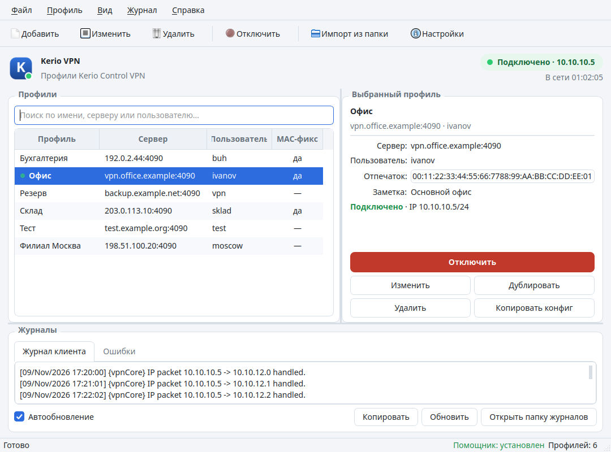
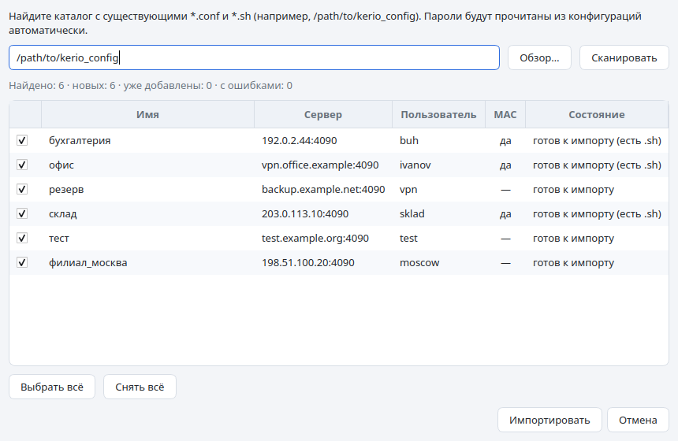
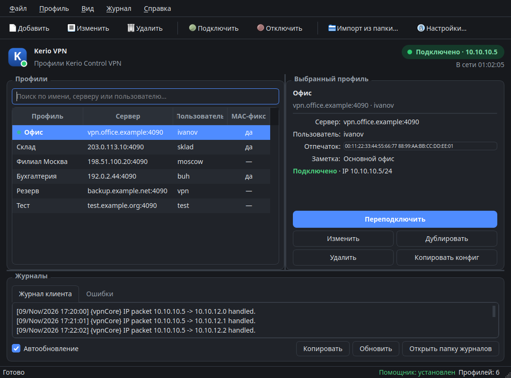

# Kerio VPN GUI

Полноценное графическое приложение для управления подключениями **Kerio Control VPN Client** в Linux (Cinnamon, GNOME, KDE, XFCE и др.). Приложение заменяет ручное создание `*.conf`/`*.sh` и запуск `/etc/init.d/kerio-kvc`: профили хранятся в домашнем каталоге, подключение выполняется одной кнопкой, статус и журналы видны в окне и в трее.



## Возможности

- Добавление, редактирование, дублирование и удаление профилей подключения.
- Поиск по профилям (имя, сервер, пользователь) при большом списке.
- Сортировка профилей по алфавиту; после переименования профиль автоматически перемещается на новую позицию.
- Изменяемая ширина колонок списка профилей — ширина запоминается между запусками.
- Хранение профилей в `~/.config/kerio-vpn-gui/profiles.json` (права `0600`).
- Импорт уже существующих конфигураций из каталога со старыми `*.conf` + `*.sh` (например, `/path/to/kerio_config`) и из `*.conf` по отдельности.
- Автоматическое чтение логина и пароля из старого конфига Kerio (пароль хранится в формате XOR 0x55, как в самом Kerio).
- Получение MD5-отпечатка сертификата с сервера прямо из диалога профиля.
- Опция «Исправлять MAC-адрес kvnet» для серверов, где использовался старый трюк с `ip link set kvnet addr …`.
- Подключение/отключение и перезапуск службы без терминала — через `pkexec` и polkit.
- Единая кнопка **Подключить/Отключить/Переключиться** в панели инструментов и в карточке профиля — состояние зависит от выбранного профиля.
- Индикатор состояния, IP-адрес и MAC туннеля, время соединения.
- Журнал клиента и журнал ошибок с автообновлением.
- Иконка в системном трее с быстрым подключением к любому профилю.
- В подсказке иконки в трее отображается название текущего подключения (собственная карточка, так как стандартный tooltip Cinnamon не показывает).
- Автозапуск при входе в систему (опционально).
- Единственный экземпляр приложения: повторный запуск показывает уже открытое окно.
- Современное оформление: светлая, тёмная или автоматическая тема как в системе.
- Настраиваемый размер шрифта (11–18 px) в **Настройки → Оформление**.
- Уведомления о подключении/отключении в стиле приложения — крупный текст и фон, соответствующий текущей теме.
- Опциональное подключение без запроса пароля администратора (правило polkit).

В Cinnamon отдельный апплет не нужен: приложение добавляет иконку в область уведомлений/трей, откуда можно подключаться к профилям и открывать окно. В стандартной панели Cinnamon уже включены апплеты `systray@cinnamon.org` и `xapp-status@cinnamon.org`.



## Темы и оформление

- Переключение темы: меню **Вид → Как в системе / Светлая / Тёмная** или **Настройки → Оформление**.
- В режиме «Как в системе» приложение определяет тему Cinnamon/GNOME через `gsettings` (`gtk-theme`, `color-scheme`) и автоматически переключается при её изменении.
- Размер шрифта выбирается в **Настройки → Оформление** (11–18 px). При изменении размера окно и ширина колонок подстраиваются, а выбранное значение сохраняется.
- Выбранная тема сохраняется в `profiles.json` и применяется при следующем запуске.
- Ширина колонок списка профилей меняется перетаскиванием границ заголовков и запоминается.

Уведомления о подключении/отключении показываются собственными карточками в правом нижнем углу: они используют текущую тему приложения, а не оформление системных уведомлений Cinnamon, и имеют увеличенный шрифт.



## Подключение без запроса пароля

По умолчанию для записи `/etc/kerio-kvc.conf` и перезапуска службы используется `pkexec`, поэтому polkit каждый раз спрашивает пароль администратора (с кэшированием на несколько минут).

Чтобы не вводить пароль при подключении:

1. Откройте **Настройки → Поведение**.
2. Включите **«Не запрашивать пароль администратора при подключении»**.
3. Один раз подтвердите запрос polkit.

Приложение создаст правило `/etc/polkit-1/rules.d/49-kerio-vpn-gui.rules`. Оно разрешает без пароля запускать **только** служебный помощник `kvc-helper` и **только** для вашего пользователя. Помощник, в свою очередь, принимает конфигурацию только от вызывающего пользователя и проверяет её структуру.

Отключить правило можно там же, сняв галочку. Это удобно, но снижает защиту: любой процесс под вашим пользователем сможет подключить VPN или заменить активный конфиг Kerio без пароля. Если это неприемлемо — оставьте галочку выключенной.

## Требования

- Linux с установленным `kerio-control-vpnclient` (проверено на 9.4.5).
- Python 3 и PyQt5: `sudo apt install python3-pyqt5`
- `pkexec` / polkit: `sudo apt install policykit-1`
- `openssl` (для получения отпечатка): `sudo apt install openssl`
- Желательно — графический агент polkit (в Cinnamon/GNOME он запускается автоматически).

## Установка

```bash
cd kerioVPN_client
./install.sh
```

Скрипт:

1. Копирует приложение в `~/.local/share/kerio-vpn-gui`.
2. Создаёт ярлык `~/.local/bin/kerio-vpn-gui` и запись в меню приложений.
3. Устанавливает служебный помощник `/usr/local/lib/kerio-vpn-gui/kvc-helper` (потребуется пароль администратора).

После установки запускайте приложение из меню **Kerio VPN** или командой:

```bash
kerio-vpn-gui
```

Если каталога `~/.local/bin` нет в `PATH`, добавьте в `~/.profile`:

```bash
export PATH="$HOME/.local/bin:$PATH"
```

## Установка из .deb

Готовые пакеты публикуются в разделе **Releases**:

https://github.com/kostya4000/kerioVPN_client/releases

Скачайте `kerio-vpn-gui_<версия>-1_all.deb` и установите:

```bash
sudo apt install ./kerio-vpn-gui_<версия>-1_all.deb
```

Пакет устанавливает приложение в `/usr/share/kerio-vpn-gui`, ярлык в `/usr/bin/kerio-vpn-gui`, иконку, desktop-файл и помощник `/usr/lib/kerio-vpn-gui/kvc-helper`. Профили и настройки по-прежнему хранятся в `~/.config/kerio-vpn-gui` и сохраняются при обновлении пакета.

Используйте **один** способ установки: `.deb` **или** `install.sh`. Если ранее уже устанавливали версию через скрипт, перед установкой `.deb` удалите её командой `./uninstall.sh` (профили и настройки сохранятся) — иначе в меню может остаться две записи «Kerio VPN», и пользовательский ярлык будет перекрывать системный.

Вместо `apt` можно использовать `sudo dpkg -i <файл>.deb`, но тогда зависимости придётся доставить через `sudo apt -f install`.

Запуск без установки (для разработки):

```bash
./bin/kerio-vpn-gui
```

В этом режиме приложение работает, но подключение недоступно, пока не установлен помощник.

## Сборка и версия

Версия приложения хранится в `kerio_vpn_gui/core.py` (`APP_VERSION`) и показывается в `--version` и в окне «О программе». При каждой сборке она повышается автоматически:

```bash
./build.sh          # patch: 1.2.0 → 1.2.1, тесты, .tar.gz + .deb + SHA256SUMS
./build.sh minor    # minor: 1.2.0 → 1.3.0
./build.sh major    # major: 1.2.0 → 2.0.0
```

Скрипт сначала запускает тесты, затем повышает версию и собирает в `dist/`:

- `kerio-vpn-gui-<версия>.tar.gz` — исходники;
- `kerio-vpn-gui_<версия>-1_all.deb` — установочный пакет;
- `SHA256SUMS` — контрольные суммы.

Каталог `dist/` исключён из git, готовые файлы прикладываются к GitHub Releases.

## Быстрый старт

1. Откройте приложение.
2. Нажмите **Импорт из папки…** и укажите `/path/to/kerio_config` — приложение найдёт все `*.conf`, прочитает серверы, логины, пароли и отметит, где нужен MAC-фикс.
   - Уже добавленные профили будут сняты с выбора, чтобы не создавать дубликаты.
   - Профили можно импортировать по одному через **Файл → Импорт из файла…**.
   - Текущий `/etc/kerio-kvc.conf` импортируется через **Файл → Импорт текущего /etc/kerio-kvc.conf**.
3. Выберите профиль и нажмите **Подключить**.
4. Подтвердите запрос polkit (пароль администратора). Он кэшируется примерно на 5 минут, поэтому отключение сразу после подключения обычно не требует повторного ввода.
5. После подключения в шапке появится IP-адрес туннеля; окно можно закрыть — приложение останется в трее.

## Как это работает

- Профиль преобразуется в XML того же формата, что и `/etc/kerio-kvc.conf`.
- Помощник через `pkexec`:
  - останавливает службу (`/etc/init.d/kerio-kvc stop` с таймаутом);
  - записывает конфигурацию в `/etc/kerio-kvc.conf` (владелец root, права `0644`);
  - запускает службу и ждёт появления процесса `kvpncsvc`;
  - при включённом MAC-фиксе ждёт в журнале новую строку `VPN driver opened … MAC …` и назначает этот MAC интерфейсу `kvnet` (аналог старых `.sh`-скриптов).
- Приложение не получает root-прав целиком: только помощник выполняет привилегированные операции, и только после подтверждения polkit.
- Статус определяется без root-прав: процесс `kvpncsvc`, интерфейс `kvnet`, адрес из `ip addr`, активный сервер из `/etc/kerio-kvc.conf`.

## Где хранятся данные

| Что | Где |
|---|---|
| Профили, настройки | `~/.config/kerio-vpn-gui/profiles.json` |
| Геометрия окна | `~/.config/kerio-vpn-gui/kerio-vpn-gui.conf` |
| Автозапуск | `~/.config/autostart/kerio-vpn-gui.desktop` |
| Помощник | `/usr/local/lib/kerio-vpn-gui/kvc-helper` |
| Правило polkit (если включено) | `/etc/polkit-1/rules.d/49-kerio-vpn-gui.rules` |
| Рабочий конфиг Kerio | `/etc/kerio-kvc.conf` |
| Журналы Kerio | `/var/log/kerio-kvc/` |

Пароли в `profiles.json` кодируются XOR 0x55 — так же, как в штатном конфиге Kerio. Это **обфускация, а не шифрование**: файл доступен только владельцу (`0600`), но при компрометации аккаунта пароли можно восстановить. Если это критично, используйте отдельного пользователя Kerio с ограниченными правами.

## Командная строка

```bash
kerio-vpn-gui                 # открыть окно
kerio-vpn-gui --minimized     # запустить в трее
kerio-vpn-gui --connect so    # подключить профиль по имени или id
kerio-vpn-gui --version
```

`--connect` удобно использовать в горячих клавишах Cinnamon или в собственных скриптах: если приложение уже запущено, команда передаётся ему через локальный сокет.

## Решение проблем

**«Помощник не установлен»**

Выполните из каталога проекта:

```bash
sudo install -D -m 755 helper/kvc-helper /usr/local/lib/kerio-vpn-gui/kvc-helper
```

или переустановите приложение через `./install.sh`.

Если не работает галочка **«Не запрашивать пароль администратора»**, значит установлен старый помощник. Обновите его через `./install.sh` — в новой версии есть команды `enable-passwordless` и `disable-passwordless`.

**Не появляется запрос пароля polkit**

Проверьте, что запущен агент аутентификации:

```bash
pgrep -af polkit
```

В Cinnamon обычно это `/usr/lib/policykit-1-gnome/polkit-gnome-authentication-agent-1`. Если его нет, установите `policykit-1-gnome` и перезайдите в сессию.

**Туннель не поднимается**

- Проверьте сервер, порт (обычно `4090`), логин и пароль.
- Нажмите «Получить с сервера» в профиле и убедитесь, что отпечаток совпадает с сертификатом Kerio.
- Посмотрите вкладку **Ошибки** и `/var/log/kerio-kvc/error.log`.
- Убедитесь, что вручную работает старый скрипт с этим же конфигом.

**Не подключается только один конкретный сервер**

Включите в профиле «Исправлять MAC-адрес kvnet после подключения» — это повторяет поведение старых `.sh`-скриптов.

**Не видно иконки в трее**

Cinnamon поддерживает трей; проверьте, что пакет `python3-pyqt5` установлен полностью. Если трей недоступен, окно просто не будет сворачиваться при закрытии.

## Удаление

```bash
./uninstall.sh           # удалить программу, сохранить профили
./uninstall.sh --purge   # удалить программу, профили и настройки
```

Помощник удаляется через `sudo`.

Если приложение установлено из `.deb`, удаляйте его через apt:

```bash
sudo apt remove kerio-vpn-gui
sudo apt purge kerio-vpn-gui   # также удалит правило polkit
```

## Структура проекта

```
kerio_client/
├── bin/kerio-vpn-gui          # лаунчер для запуска из исходников
├── helper/kvc-helper          # привилегированный помощник (pkexec)
├── kerio_vpn_gui/
│   ├── core.py                # профили, XOR, XML, импорт
│   ├── backend.py             # служба, статус, журналы, отпечаток
│   ├── theme.py               # светлая/тёмная тема и QSS
│   ├── toast.py               # всплывающие уведомления в теме приложения
│   ├── ui.py                  # окно, диалоги, трей
│   └── __main__.py            # CLI и single-instance
├── assets/                    # иконка и скриншоты
├── tests/test_core.py         # тесты модели и импорта
├── scripts/bump_version.py    # повышение APP_VERSION
├── packaging/build_deb.sh     # сборка .deb
├── build.sh                   # тесты + bump версии + .tar.gz и .deb
├── install.sh
└── uninstall.sh
```

Тесты:

```bash
PYTHONPATH=. python3 -m unittest discover -s tests -v
```

## Примечание

Приложение не является официальным продуктом Kerio Technologies. Оно лишь управляет штатным клиентом `kerio-control-vpnclient` и файлом `/etc/kerio-kvc.conf`.

Ссылка на репозиторий также доступна в приложении: **Справка → О программе**.
